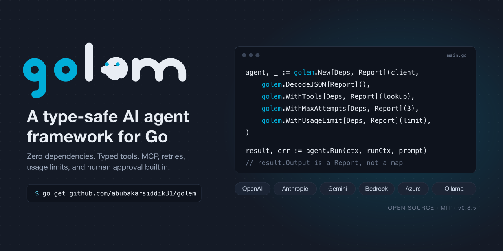
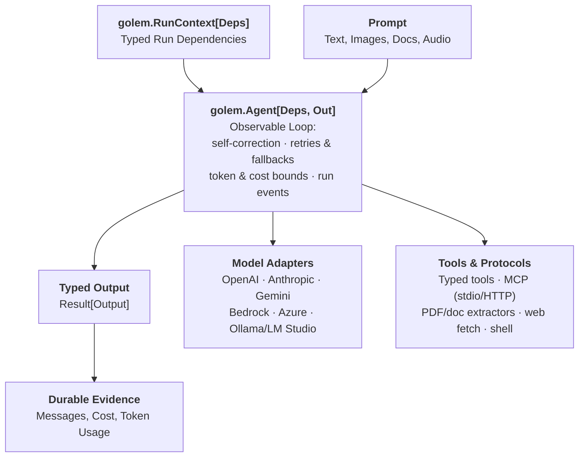

<p align="center">
  
</p>

<p align="center">
  <strong>A Go-first framework for building dependable, production-grade AI agents.</strong><br>
  Compile-time type safety, zero external dependencies, explicit execution control, and deep MCP integration.
</p>

<p align="center">
  <a href="https://pkg.go.dev/github.com/abubakarsiddik31/golem"></a>
  <a href="https://github.com/abubakarsiddik31/golem/actions/workflows/ci.yml"></a>
  <a href="https://abubakarsiddik31.github.io/golem/"></a>
  <a href="go.mod"></a>
  <a href="LICENSE"></a>
  <a href="https://github.com/abubakarsiddik31/golem/releases"></a>
</p>

<p align="center">
  <a href="https://abubakarsiddik31.github.io/golem/"><strong>Read the Documentation »</strong></a>
</p>

---

## Why Golem?

Python frameworks like Pydantic AI made agent prototyping easy. Production systems need Go's concurrency, predictable memory, and small binaries. Golem brings typed agents to Go:

- **Type-safe:** `Agent[Deps, Output]` and `RunContext[Deps]` give tools typed dependencies and typed results. No `map[string]any`.
- **Zero dependencies:** standard library only, so builds are fast and the supply-chain surface is small.
- **Any model:** OpenAI, Anthropic, Gemini, Bedrock, Azure, Groq, DeepSeek, Ollama, and LM Studio.
- **Self-correcting:** the model can retry bad tool calls or output (`ModelRetry`), with fallback models, backoff, and per-tool timeouts.
- **Auditable:** every run returns messages, token usage, cost, and live events. A failed run keeps its partial evidence (`RunError.Partial`).
- **Human-in-the-loop:** pause a run for approval or an external result, then resume it.
- **Built-in tools:** MCP client and server, PDF, Office, web, file, and shell tools, plus skills, planning, and memory.
- **Cost-bounded:** cap tokens, requests, tool calls, or dollars per run.

---

## How Golem Compares

Against the other actively maintained Go agent frameworks: [langchaingo](https://github.com/tmc/langchaingo), [Eino](https://github.com/cloudwego/eino), and [Genkit (Go)](https://github.com/firebase/genkit).

| | **Golem** | langchaingo | Eino | Genkit |
| --- | :---: | :---: | :---: | :---: |
| Dependencies | **None** (stdlib) | Many | Several | Several |
| Typed tool dependencies | ✅ | ❌ | Partial | ❌ |
| Built-in MCP client | ✅ | ❌ | ❌ (`eino-ext`) | ❌ |
| Self-correction (`ModelRetry`) | ✅ | ❌ | Partial | ❌ |
| Model fallback | ✅ | ❌ | ❌ | ❌ |
| Pause and resume for humans | ✅ | ❌ | ✅ | Experimental |
| Token and cost limits | ✅ | ❌ | ❌ | ❌ |
| Offline test model | ✅ | ❌ | ❌ | ❌ |
| PDF, Office, web, shell tools | ✅ | Partial | ❌ | ❌ |
| Design | Linear loop | Chains | Graphs | Flows |

- **Choose Golem** for a dependency-free, typed, production-guarded agent loop.
- **Choose Eino** for branching or parallel multi-agent graphs and a larger component ecosystem.
- **Choose langchaingo** for the widest provider and vector-store coverage.
- **Choose Genkit** for Google tooling (Developer UI, tracing, evaluation) and tight Gemini integration.

*Based on each project's public docs and source as of October 2026. Verify against upstream before depending on a specific behavior.*

---

## Architecture

Golem orchestrates agents through a transparent, observable execution loop:



---

## Installation

```bash
go get github.com/abubakarsiddik31/golem
```

Requires **Go 1.26** or newer. Zero external dependencies.

---

## Quick Start

### 1. Minimal Agent

Initialize a model adapter, create a typed agent, and execute a prompt:

```go
package main

import (
	"context"
	"fmt"
	"os"

	"github.com/abubakarsiddik31/golem"
	"github.com/abubakarsiddik31/golem/model"
	"github.com/abubakarsiddik31/golem/providers/openai"
)

func main() {
	client, err := openai.New(openai.Config{
		APIKey: os.Getenv("OPENAI_API_KEY"),
		Model:  "gpt-4o-mini",
	})
	if err != nil {
		panic(err)
	}

	agent, err := golem.New[struct{}, string](client,
		golem.DecodeFunc[string](func(_ context.Context, r model.Response) (string, error) {
			return r.Message.Content, nil
		}),
	)
	if err != nil {
		panic(err)
	}

	result, err := agent.Run(context.Background(), golem.RunContext[struct{}]{}, "Why is Go ideal for AI agents?")
	if err != nil {
		panic(err)
	}

	fmt.Println(result.Output)
	fmt.Printf("Tokens: %d input, %d output\n", result.Usage.InputTokens, result.Usage.OutputTokens)
}
```

### 2. Next steps

- **Typed tools with dependency injection:** tools receive your database, auth context, or HTTP client through `RunContext[Deps]`. See [Tools and dependencies](docs/guides/tools-and-dependencies.md) and the [`tools`](examples/tools/main.go) example.
- **Structured output:** get typed Go structs back with `golem.DecodeJSON[T]()` and schema enforcement. See [Structured output](docs/guides/structured-output.md) and the [`structured-output`](examples/structured-output/main.go) example.

---

## Supported Providers

Golem ships with standard-library-only adapters for all major frontier and open-weight models:

| Provider | Adapter Package | Streaming | Thinking / Reasoning | Multimodal | Embeddings | Token Counting |
| --- | --- | :---: | :---: | :---: | :---: | :---: |
| **OpenAI** | `providers/openai` | :white_check_mark: | :white_check_mark: | :white_check_mark: | :white_check_mark: | — |
| **Anthropic** | `providers/anthropic` | :white_check_mark: | :white_check_mark: | :white_check_mark: | — | :white_check_mark: |
| **Google Gemini** | `providers/gemini` | :white_check_mark: | :white_check_mark: | :white_check_mark: | :white_check_mark: | :white_check_mark: |
| **AWS Bedrock** | `providers/bedrock` | :white_check_mark: | :white_check_mark: | :white_check_mark: | — | :white_check_mark: |
| **Azure OpenAI** | `providers/azure` | :white_check_mark: | :white_check_mark: | :white_check_mark: | :white_check_mark: | — |
| **Ollama / Local** | `providers/openai` | :white_check_mark: | :white_check_mark: | :white_check_mark: | :white_check_mark: | — |
| **DeepSeek** | `providers/openai` | :white_check_mark: | :white_check_mark: (`reasoning_content` + `<think>`) | — | — | — |
| **Groq** | `providers/groq` | :white_check_mark: | :white_check_mark: | — | — | — |
| **OpenAI-Compatible** | `providers/openai` | :white_check_mark: | :white_check_mark: | :white_check_mark: | :white_check_mark: | — |

---

## Testing Without a Provider

Never mock HTTP endpoints or pay for tokens in unit tests. Golem includes `testmodel`, a fully deterministic, offline model implementation:

```go
package main

import (
	"context"
	"testing"

	"github.com/abubakarsiddik31/golem"
	"github.com/abubakarsiddik31/golem/model"
	"github.com/abubakarsiddik31/golem/testmodel"
)

func TestAgent(t *testing.T) {
	client := testmodel.New().Respond(
		model.Response{Message: model.Message{Role: model.RoleAssistant, Content: "pong"}},
	)

	agent, _ := golem.New[struct{}, string](client,
		golem.DecodeFunc[string](func(_ context.Context, r model.Response) (string, error) {
			return r.Message.Content, nil
		}),
	)

	result, err := agent.Run(context.Background(), golem.RunContext[struct{}]{}, "ping")
	if err != nil || result.Output != "pong" {
		t.Fatalf("unexpected result: %v, output: %s", err, result.Output)
	}
}
```

---

## Documentation

Each capability has a guide in [`docs/guides/`](docs/guides/), also published at [abubakarsiddik31.github.io/golem](https://abubakarsiddik31.github.io/golem/). Design records live in [`docs/adr/`](docs/adr/).

- **Start here:** [Getting started](docs/guides/getting-started.md) · [Providers](docs/guides/providers.md) · [Testing without a provider](docs/guides/testing.md)
- **Tools:** [Tools and dependencies](docs/guides/tools-and-dependencies.md) · [Tool timeouts](docs/guides/tool-timeouts.md) · [Tool search](docs/guides/tool-search.md) · [Deferred tools](docs/guides/deferred-tools.md) · [Agent delegation](docs/guides/agent-delegation.md) · [Orchestration](docs/guides/orchestration.md)
- **Common tools:** [Web fetch](docs/guides/web-fetch.md) · [Web search](docs/guides/web-search.md) · [File read](docs/guides/file-read.md) · [Command execution](docs/guides/command-execution.md) · [PDF extract](docs/guides/pdf-extract.md) · [Document extract](docs/guides/doc-extract.md) · [Agent skills](docs/guides/skills.md) · [Planning](docs/guides/planning.md) · [Memory](docs/guides/memory.md)
- **MCP:** [MCP client](docs/guides/mcp-client.md) · [MCP server](docs/guides/mcp-server.md)
- **Output and reliability:** [Structured output](docs/guides/structured-output.md) · [Self-correction](docs/guides/self-correction.md) · [Retries](docs/guides/retries.md) · [Guardrails](docs/guides/guardrails.md) · [Content filter](docs/guides/content-filter.md) · [Loop detection](docs/guides/loop-detection.md) · [Usage limits](docs/guides/usage-limits.md)
- **Conversations and context:** [Conversations and history](docs/guides/conversations-and-history.md) · [Compaction](docs/guides/compaction.md) · [Sessions](docs/guides/sessions.md) · [Prompt context](docs/guides/prompt-context.md) · [Multimodal input](docs/guides/multimodal-input.md) · [Thinking](docs/guides/thinking.md)
- **Retrieval, tokens, and cost:** [Embeddings](docs/guides/embeddings.md) · [Retrieval](docs/guides/retrieval.md) · [Token counting](docs/guides/token-counting.md) · [Cost](docs/guides/cost.md)
- **Observability:** [Streaming](docs/guides/streaming.md) · [Run events](docs/guides/run-events.md) · [Tracing](docs/guides/tracing.md)

---

## Examples

Runnable programs live in [`examples/`](examples/), one per capability. Provider-backed examples read their API key from the environment and exit with instructions when it is unset; the rest run offline.

- **Start here:** [`minimal`](examples/minimal/main.go) · [`tools`](examples/tools/main.go) · [`structured-output`](examples/structured-output/main.go) · [`structured-output-tool`](examples/structured-output-tool/main.go) · [`conversation`](examples/conversation/main.go) · [`cli-assistant`](examples/cli-assistant/main.go) · [`testing-without-a-provider`](examples/testing-without-a-provider/main.go)
- **Providers:** [`anthropic`](examples/anthropic/main.go) · [`gemini`](examples/gemini/main.go) · [`azure`](examples/azure/main.go) · [`bedrock`](examples/bedrock/main.go) · [`groq`](examples/groq/main.go) · [`deepseek`](examples/deepseek/main.go) · [`local-models`](examples/local-models/main.go) · [`fallback`](examples/fallback/main.go)
- **Tools and MCP:** [`tool-results`](examples/tool-results/main.go) · [`tool-preparation`](examples/tool-preparation/main.go) · [`tool-output-limit`](examples/tool-output-limit/main.go) · [`tool-output-spill`](examples/tool-output-spill/main.go) · [`tool-search`](examples/tool-search/main.go) · [`deferred-tools`](examples/deferred-tools/main.go) · [`self-correction`](examples/self-correction/main.go) · [`loop-detection`](examples/loop-detection/main.go) · [`mcp-client`](examples/mcp-client/main.go) · [`mcp-http`](examples/mcp-http/main.go) · [`mcp-auth`](examples/mcp-auth/main.go) · [`mcp-server`](examples/mcp-server/main.go) · [`mcp-elicitation`](examples/mcp-elicitation/main.go) · [`skills`](examples/skills/main.go) · [`planning`](examples/planning/main.go) · [`memory`](examples/memory/main.go) · [`memory-files`](examples/memory-files/main.go)
- **Common tools:** [`web-search`](examples/web-search/main.go) · [`web-fetch`](examples/web-fetch/main.go) · [`file-read`](examples/file-read/main.go) · [`command-execution`](examples/command-execution/main.go) · [`pdf-extract`](examples/pdf-extract/main.go) · [`doc-extract`](examples/doc-extract/main.go) · [`ocr-scanned-pdf`](examples/ocr-scanned-pdf/main.go)
- **Agents and workflows:** [`delegation`](examples/delegation/main.go) · [`orchestration`](examples/orchestration/main.go)
- **Context, history, and cost:** [`session`](examples/session/main.go) · [`compaction`](examples/compaction/main.go) · [`history-repair`](examples/history-repair/main.go) · [`history-sanitization`](examples/history-sanitization/main.go) · [`partial-evidence`](examples/partial-evidence/main.go) · [`run-cancellation`](examples/run-cancellation/main.go) · [`run-ids`](examples/run-ids/main.go) · [`token-counting`](examples/token-counting/main.go) · [`cost`](examples/cost/main.go) · [`embeddings`](examples/embeddings/main.go) · [`retrieval`](examples/retrieval/main.go) · [`multimodal-input`](examples/multimodal-input/main.go) · [`thinking`](examples/thinking/main.go) · [`prompt-template`](examples/prompt-template/main.go) · [`citations`](examples/citations/main.go)
- **Safety and observability:** [`guardrails`](examples/guardrails/main.go) · [`content-filter`](examples/content-filter/main.go) · [`streaming`](examples/streaming/main.go) · [`run-events`](examples/run-events/main.go) · [`tracing`](examples/tracing/main.go)

To run any example:

```bash
# Run with OpenAI
OPENAI_API_KEY=sk-... go run ./examples/minimal

# Run locally with Ollama or LM Studio
GOLEM_LOCAL_BASE_URL=http://localhost:11434/v1 go run ./examples/local-models

# Run offline examples (no credentials needed)
go run ./examples/testing-without-a-provider
go run ./examples/pdf-extract
go run ./examples/ocr-scanned-pdf
go run ./examples/deferred-tools
go run ./examples/partial-evidence
```

---

## Package Structure

```text
golem/        Agent configuration and typed run API
model/        Provider-neutral model request/response contract
tool/         Tool declarations and execution contracts
guard/        Guards at the run's boundaries (prompts, tool calls, results, output)
session/      Store port for conversations that persist between runs
tokens/       Token counting port for budgets and pre-send limits
embedding/    Embedder port: queries, documents, usage
retrieval/    Index port: cosine top-k search and the search_documents tool
telemetry/    Tracing port with an SDK-free OpenTelemetry adapter
mcp/          Model Context Protocol client (stdio & streaming HTTP)
mcpserver/    Expose one Golem agent as an MCP tool (stdio or stateless HTTP)
pdfextract/   Common tool: layout-aware PDF parser (tables, images, text)
docextract/   Common tool: Word, Excel, PowerPoint, CSV, and Markdown extractor
webfetch/     Common tool: fetch a URL as agent-readable text
websearch/    Common tool: ranked web search behind a backend port
fileread/     Common tool: read a file as agent-readable text
shell/        Common tool: run one command, return combined output
skills/       Common tool: standard SKILL.md folder progressive loader
planning/     Toolset: model-owned task plan behind a store port
memory/       Toolset: persistent namespaced Markdown notebook behind a store port
providers/    Stdlib-only adapters implementing model.Model
testmodel/    Deterministic in-memory model doubles for unit testing
internal/     Execution runner loop and private mechanics
examples/     Runnable programs per capability
assets/       Brand assets
scripts/      Coverage, API-compatibility, benchmark, and smoke-test scripts
docs/guides/  Feature guides (source of truth for behavior)
docs/adr/     Decisions that shape public contracts
```

---

## Status & Roadmap

Golem is stable: see the [latest release](https://github.com/abubakarsiddik31/golem/releases) and the [changelog](CHANGELOG.md).

The core execution contract is frozen and verified with continuous race-detector CI, memory fuzzing, and deterministic offline tests. Since v1.0.0 the public API follows SemVer with additive-only changes below v2, checked by API diff on every release (ADR 0041).

For architecture rationale, read [the foundation brief](docs/foundation.md). For upcoming milestones, read the [development roadmap](docs/ROADMAP.md). For measured costs and how to run the benchmarks, read [the benchmark baseline](docs/benchmarks.md).

---

## Development

Run the test suite and verification checks:

```bash
go test ./...
go test -race ./...
go vet ./...
```

The feature guides publish as the official documentation site; preview it locally with `mkdocs serve` (see [docs/website.md](docs/website.md)). Brand assets and guidelines live in [assets/brand/](assets/brand/README.md).

---

## Community & Contributing

Golem is an open-source project and actively welcomes community contributions!

- [Good First Issues](https://github.com/abubakarsiddik31/golem/issues?q=is%3Aissue+is%3Aopen+label%3A%22good+first+issue%22) — approachable issues scoped for newcomers
- [Roadmap](docs/ROADMAP.md) — direction, open items, and design decisions
- [GitHub Discussions](https://github.com/abubakarsiddik31/golem/discussions) — ask usage questions, share architectures, and propose RFCs
- [Issues](https://github.com/abubakarsiddik31/golem/issues) — bug reports and concrete feature requests, not general questions
- [Contributing Guide](CONTRIBUTING.md) — instructions for setting up, running checks, and submitting changes
- [Security Policy](SECURITY.md) — guidelines for privately reporting vulnerabilities
- [Code of Conduct](CODE_OF_CONDUCT.md) — standards for participation

---

## License

Released under the [MIT License](LICENSE).
