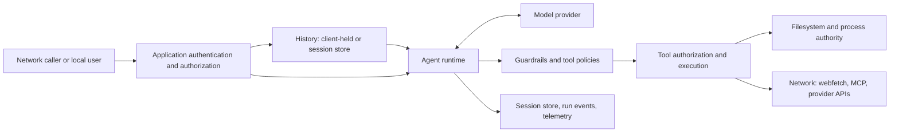

# Golem threat model

This document maps the security boundaries in Golem: where attacker-controlled
inputs enter, which resources they can reach, and which component owns each
control. It helps reviewers and reporters evaluate a finding against the
framework's documented boundaries. Option-level detail lives in the guides;
this document is the map of who owns what.

The model follows the working-draft pattern of Pydantic AI's threat model
(`reference/pydantic-ai/THREAT_MODEL.md`) and the OWASP Gen AI risk framing:
prompt injection is assumed, authorization lives in tool code, and a library
boundary is only as strong as its documented control.

## Scope and deployment profiles

The same agent can run inside applications with different authority. Evaluate
a report against the affected profile.

| Profile | Authority and boundary |
|---|---|
| Server application embedding `golem.Agent` | The application owns authentication, tenant identity, tool authorization, provider credentials, and access to stored state. |
| Server accepting client-held history | History arrives per request from the client (the `RunWithHistory` pattern). The application owns its validation; `golem.SanitizeHistory` is the library's input cleaner, and `WithSessionRequired` rejects the pattern in favor of server-held history. |
| Server-held history | The conversation comes only from a `session.Store` the application controls. Resolutions on a paused run answer only the calls the stored history is waiting on. |
| Local CLI or batch application | Tools execute with the launching process's authority. Golem's per-tool policies shape that authority; the OS owns isolation. |
| Shared agent, concurrent runs | One agent serves many requests. The agent is safe for concurrent use; conversation scoping and tenant binding stay application responsibilities. |

Examples and documentation snippets show how to use an API; they are not
hardened deployments. A flaw in one is a documentation bug for a public
issue, unless the library code it calls breaks a documented boundary.

A vulnerability in a dependency (including MCP servers and their transports)
belongs to that project. A Golem check that relies on documented platform
behavior — `filepath` resolution, for instance — is still a library control,
so a bypass of that check is a Golem vulnerability.

## Assets and adversaries

Review these assets:

- User conversations, tool results, stored conversations, and deferred
  actions awaiting resolution.
- Server instructions, provider identifiers, API keys, internal endpoints,
  and telemetry.
- Files, processes, network destinations, and external services reachable
  by tools or provider credentials.
- Availability and cost of model requests, tool executions, and shared
  resources.

An attacker may control: a network request, client-supplied history, a URL,
fetched content, an MCP server's responses and tool definitions, a
repository file a tool reads, or content the model uses to choose tool
arguments. **Treat model-generated tool arguments as untrusted input to the
tool implementation.** `PendingToolCall.Args` is model-produced JSON for the
same reason: validate before trusting it.

Trusted application code chooses the agent's tools, dependencies,
credentials, guards, and session store. Registering a tool delegates
authority; schema validation and system instructions do not establish the
caller's permission to exercise it.

## Data flow

The hosting application controls which callers may enter this flow. Tools,
guards, stores, and the telemetry observer enforce different controls after
entry. Check each crossing in both directions: incoming data can select an
operation or resource, and outgoing data can disclose protected information.

## Core boundaries

### Client-held history and server-held history

History supplied to `RunWithHistory` or `RunWithDeferredResults` is trusted
as application-authored. An application accepting it from a client must
apply `golem.SanitizeHistory` and its own validation — and must understand
what trust means on the deferred path: a client-supplied history also
supplies the tool calls an approval re-executes, arguments included. A
forged history naming a call ID the model never made is validated against
that same forged history.

`golem.WithSessionRequired()` closes that door: the session store becomes
the only conversation source, caller-supplied history is rejected before
any model call, and a resolution — approval, denial, or external result —
can only answer a call the stored conversation is waiting on, with the
arguments the server stored.

Sanitization and session enforcement do not authenticate a client or prove
that an approval came from a genuine paused run. **Approval is a
human-in-the-loop gate, not an authorization boundary**: enforce who may
act inside the tool, against the run's dependencies. Canonical guidance:
the sessions guide ("Server-held history"), the guardrails guide, and
`TestSessionRequiredResumeAnswersOnlyStoredCalls`, the contract test for
the boundary.

### Tool actions, approvals, and prompt injection

Tool implementations must authorize the requested action using trusted
application identity and policy. Schema validation checks the argument
shape; a valid argument can still name an unauthorized account, file, or
URL. Untrusted content — fetched pages, MCP responses, repository files,
tool results — can influence model decisions. System instructions,
delimiters, and a guard's refusal text are not substitutes for
authorization in tool code.

Golem's controls on this path shape behavior; none isolates:

- **Guardrails** (`guard` package, ADR 0042) screen prompts, tool calls,
  tool results, and outputs. They are guardrails against accidents: blocks
  are graceful, the model sees the refusal text, and a model that wants to
  work around a guard can try.
- **The shell command policy** (`shell.Config`) denies listed
  commands, operators, and interactive executables before any process
  starts. A command filter is not process isolation: an allowlist's
  executables still run with the process's full OS authority.
- **Deferred approval** (`tool.Deferred`, `tool.CallApproved`) pauses an
  action until the application relays a decision. It protects only the
  operations the tool actually gates: an unguarded code path in the same
  tool has no approval.

Canonical guidance: the tools-and-dependencies, command-execution,
guardrails, and deferred-tools guides.

### URL fetching and file access

URLs can select resources reachable with the server's network access. The
webfetch tool's address guard blocks loopback, private, link-local,
multicast, unspecified, and carrier-grade NAT addresses by default; a
blocked address is a policy failure, not a correctable model mistake.
Applications that opt into private destinations must authorize those
destinations themselves. A domain the model names inside another tool — or
inside MCP content — is not covered by the webfetch guard; every transport
that performs a fetch owns its own address checks.

The fileread tool is root-jailed: paths resolve against a configured root,
rejecting absolute paths, traversal, and symlinks that escape. Its checks
are subject to check/use races like any path-based control; untrusted
writers in the same directory can race them. The filesystem outside a
jailed tool — shell commands, other tools, MCP servers — is not covered by
the jail.

Canonical guidance: the web-fetch and file-read guides.

### MCP connections

MCP servers exchange tool definitions, tool arguments, and content with the
run. Server-provided tool definitions reach the model request verbatim;
server-provided content is untrusted and can steer the model like any
external content. The application chooses trusted server endpoints,
credentials, and tools, and authorizes the operations it exposes. Transport
authentication does not establish the identity of the application's own
caller. Canonical guidance: the mcp-client guide.

### Persistent state and tenant identity

The application must bind conversation IDs, session stores, and deferred
results to the authorized user. A conversation ID supplied by a client is
not proof of ownership. The session store holds conversations verbatim —
tool evidence, thinking blocks, and identity stamps included — so store
them somewhere the deployment's threat model accepts; `session.Memory`
keeps everything in the process and persists nothing. A paused run's
transcript is saved, so a store that outlives the process holds unresolved
approval requests; access to that store is access to those requests.
Canonical guidance: the sessions guide.

### Telemetry and secrets

Messages, tool arguments, results, and error messages can contain secrets.
The telemetry observer records content **verbatim by default**;
`telemetry.WithContentExcluded()` keeps content off spans (arguments and
results become byte sizes, errors are recorded by type only),
`telemetry.WithRedactor(fn)` scrubs it. A content mode that drops one
attribute does not establish that the content is absent everywhere: run
events (`WithRunEvents`) hand the same bytes to application observers, and
error strings can quote arguments and refusals. A tracing backend is not a
secret store. Canonical guidance: the tracing guide ("Keeping content off
the spans").

### Availability and resource lifetime

Untrusted input affects model usage, tool runtime, downloads, and shared
resources. Golem's allocation controls are per-run: usage limits
(`Requests`, `ToolCalls`, `Cost`), tool timeouts, model-retry and
tool-retry budgets, and the maximum-iteration bound on the loop. Per-run
limits bound one run's own consumption; they do not establish tenant-wide
admission or provider spend controls. Content the model or a tool produces
can be large; observers and decoders run inline with execution, so an
application observer that buffers unboundedly owns that growth.
Canonical guidance: the usage-limits, tool-timeouts, and retries guides.

## Published failure patterns to review against

No advisories are published for Golem yet. When one is, record it here with
the pattern it exemplifies. Until then, these are the patterns to check when
a component or control changes, drawn from the cross-framework analysis that
motivated this document (see `docs/adr/0042-guardrails.md` and the sessions
guide's security property):

- URL checks and network resolution disagree — alternate address forms,
  redirects, metadata access, and per-transport address enforcement.
- A control applies after expensive or irreversible work — guards run
  before tool execution; approval runs before the gated action; a guard
  that runs after a side effect cannot undo it.
- A content-exclusion misses a secondary channel — spans, events,
  exceptions, and error strings are separate export paths.
- Client-supplied history changes what executes — the stored conversation
  is the only validation source under `WithSessionRequired`; a bypass
  there is a vulnerability.
- Cost grows super-linearly with untrusted input — history processing,
  sanitization, and guard chains all touch client-controlled content.

## Report-evaluation questions

Use the affected component's current documented boundary when evaluating a
report.

1. What version, deployment profile, and configuration is affected?
2. What input can the attacker control, and what access is required?
3. Which implementation path carries that input to the protected resource?
4. What concrete confidentiality, integrity, or availability consequence
   can be reproduced?
5. Which library control or application responsibility governs that path?
6. Does the proposed fix repair that boundary, or introduce a new
   guarantee? Which regression test proves it?

A configuration-dependent report needs explicit deployment assumptions.
Severity scoring and the decision to publish an advisory are maintainer
judgment; see `SECURITY.md` for the reporting channel.

## Keeping this model current

Update this document in the PR that adds an input path, transfers
authority, changes a trust or disclosure default, or changes a tool's
guarantee. Keep option-level detail in the canonical guide and point here
for the boundary it enforces.
